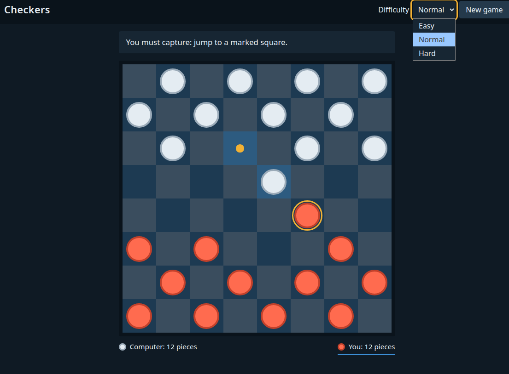

# Checkers

A simple, standalone version of the classic board game, for one player against the computer.

**[Play it online](https://onckelinx.github.io/checkers/)**

**Or play offline:** download this repository (**Code → Download ZIP**), unzip it and double-click `index.html`. There is nothing to install.

- Standard American rules on an 8×8 board: compulsory captures, multi-jumps and kings
- Three difficulty levels, up to an opponent that looks 8 turns ahead
- Plain HTML, CSS and JavaScript, with no dependencies

Released under the [MIT License](LICENSE).
